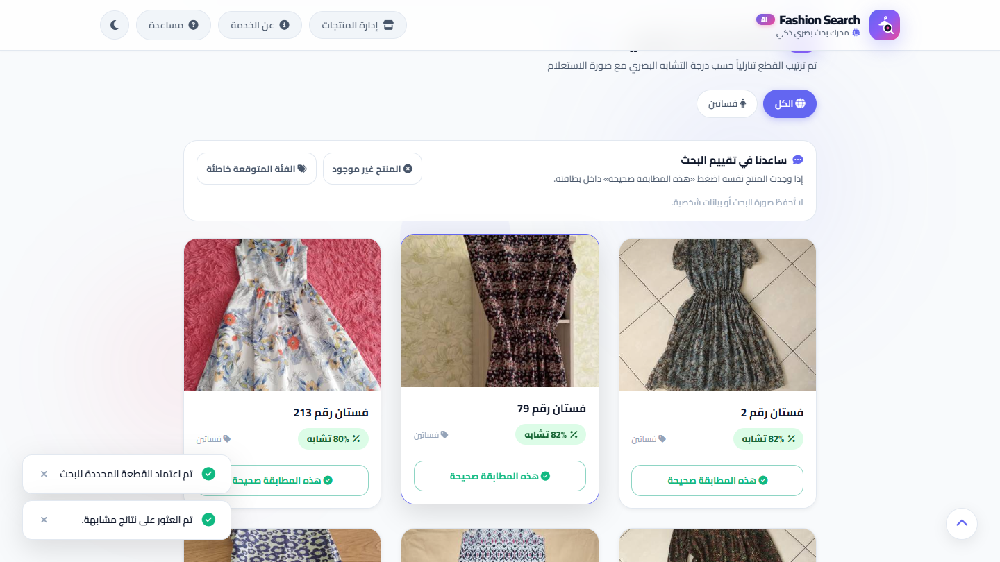

# LibaasLens | عدسة لباس

**Visual Fashion Product Search Using Interactive Segmentation**

Upload a clothing photograph, select the intended garment, and explore visually similar items in a local catalogue. LibaasLens combines **SigLIP2**, **SAM2.1**, **FAISS**, **FastAPI** and **SQLite** in a browser application.

A graduation project at **International University of Technology Twintech**, developed by **Nasser Yousef · Noor Yousef · Naeem Basalma**, supervised by **Dr. Ayman Alsabri**.

[العربية](README_AR.md) · [Documentation](docs/INDEX.md) · [Run locally](#run-locally) · [Submission materials](#submission-materials) · [Authors and rights](#authors-and-rights)



*Actual application results. Similarity scores describe visual resemblance; they are not calibrated probabilities of exact product identity.*

## What you can do

- Search a complete image, or isolate the intended garment using SAM2.1 positive/negative points.
- Review the cutout before searching, or select a region manually with rectangle, polygon and freehand tools.
- Search the **original 3,068-image research gallery** or a separate **managed-product catalogue**.
- Correct the category or search across categories.
- Manage products through one protected local administrator: add, edit, delete, attach 1–5 photos, set optional price/currency and availability, and export/restore catalogue backups.

Visitors can search without an account. The current application runs locally; it does not implement seller accounts, checkout, payments or a city-wide store directory.

## How search works

```text
Full photograph ──────────────────────────────┐
Photo + SAM2.1 points → accepted cutout ──────┤
Photo + manual region → selected image ──────┘
                     ↓
           Shared image preparation
                     ↓
          SigLIP2 image encoder (768-D)
                     ↓
       Category control + exact FAISS ranking
                     ↓
            Visually similar products
```

The models use pretrained weights. `IndexFlatIP` ranks normalised vectors; FAISS runs on CPU, while neural inference supports CUDA with CPU fallback. The original gallery uses a saved index. Added products keep photos and vectors in SQLite and appear once per product using the best matching photo.

## Results and evidence

| Study | Queries | Recorded result | What it measures |
| --- | ---: | --- | --- |
| Historical encoder comparison | 341 validation images | SigLIP2 category P@1 **91.50%**, highest of five compared encoders | Category relevance in that comparison |
| Historical multi-garment test | 100 synthetic composite queries | Full image **46%** → selected garment **75%**, **+29 percentage points** | Category of the first result, not exact SKU identity |
| Separate application-aligned category study | 372 clean test images | Unrestricted **92.20%** → automatic category **96.24%** | Category relevance under a different protocol |

These experiments have different inputs and processing contracts and must not be pooled. The original gallery index remains active because catalogue cropping did not show a sufficient consistent improvement. The seven-group reviewed identity pilot is exploratory, not a general identity-accuracy claim.

Recorded verification on **12 November 2026** passed 197 Python tests, 43 JavaScript tests, 32 live HTTP checks, 15 isolated administration checks and 55 evidence checks. These are separate functional/evidence checks, not accuracy denominators. See [the verification record](docs/final_report/VERIFICATION_SUBMISSION.json) and [the detailed protocols](docs/TECHNICAL_GUIDE.md).

## Run locally

**On the team's configured Windows computer:** double-click `Start_Demo.cmd` or the existing desktop shortcut. Open <http://127.0.0.1:8000/> after readiness. PyCharm is not required.

**For a clean installation:** get the [verified runtime resources](https://github.com/nasserco09/LibaasLens/releases/tag/runtime-rc9-v1). Download the 28 parts and assembly support files, run `Assemble_Runtime.cmd`, and verify the assembled ZIP. Extract into a new folder, install Python 3.12 x64, run `Setup_Runtime.cmd`, then `Start_Demo.cmd`.

The runtime includes the two active models, gallery images, original index and application files. Python and dependency installation are separate; initial setup needs internet or compatible local wheels. Personal administrator accounts, added products and telemetry are excluded. **A Git clone alone does not contain the model weights and gallery.**

[Windows runtime instructions](RUNTIME_README_AR.md) · [Distribution and checksums](docs/RUNTIME_DISTRIBUTION_AR.md) · [Local demo guide](docs/LOCAL_PRESENTATION_AR.md)

## Submission materials

[Download the university submission release](https://github.com/nasserco09/LibaasLens/releases/tag/submission-2026-v2) for the current materials and attribution files. The application runtime resources are a separate download linked above.

| Material | Current files |
| --- | --- |
| Report | [Submission PDF](docs/final_report/preview/AI_Visual_Product_Search_Submission_2026.pdf) · [Editable LaTeX](docs/final_report/README_AR.md) |
| Presentation | [Editable PowerPoint](docs/final_presentation/exports/Visual_Fashion_Search_Defense_2026_v3.pptx) · [Reading PDF](docs/final_presentation/exports/Visual_Fashion_Search_Defense_2026_v3.pdf) |
| Poster | [Print PDF, 250 × 140 cm](docs/poster/preview/Visual_Fashion_Search_Poster_250x140cm.pdf) · [Editable artwork](docs/poster/README_AR.md) |
| Project video | [Silent application walkthrough, 49 seconds, 1080p](docs/final_video/exports/LibaasLens_Application_Walkthrough_Silent_v2.mp4) · [Editable production sources](docs/final_video/README_AR.md) |
| Handover | [Delivery structure and verification](docs/submission/README_AR.md) · [University status](docs/UNIVERSITY_SUBMISSION_2026_AR.md) |

The team approved the presentation and confirmed the local application works on **14 November 2026**. At the team's subsequent request, video v2 replaces the narrated presentation-style video with a short, silent recording of application usage, English guidance and the university logo. The previous video remains available in the v1 snapshot. Genuine approval signatures and stamps remain the university signatories' responsibility. **LibaasLens** is the project's short name.

## Project map

| Path | Purpose |
| --- | --- |
| `app.py`, `backend/`, `frontend/` | Active application and interface |
| `tests/` | Python and frontend checks |
| `evaluation/` | Protocols, experiments and retained results |
| `runtime/`, `tools/` | Resource notices, setup, launch and verification tools |
| `docs/` | Submission materials and technical documentation |

Application reference: **v1.2.0-rc.9**. The stable/default branch is `main`; `feature/frontend-v2` is retained for development. The old main was advanced without rewriting history. [Earlier discussion files](docs/preliminary_discussion/README_AR.md) are retained for history and are not the current submission.

## Authors and rights

**Copyright © 2026 Nasser Yousef, Noor Yousef and Naeem Basalma.** Original team-owned material is provided with rights reserved; university assessors may use the submitted version for academic evaluation under the limited permission in [LICENSE](LICENSE). This is not a general open-source or commercial-use grant. [AUTHORS](AUTHORS.md) records the team and supervisor, and [CITATION.cff](CITATION.cff) provides citation metadata.

Third-party models, datasets, libraries, fonts and branding retain their respective rights and licences. See [third-party notices](THIRD_PARTY_NOTICES.md) and [ownership details in Arabic](COPYRIGHT_AR.md). Repository visibility and commit history document publication and provenance; they do not themselves register a trademark or determine university IP ownership.
