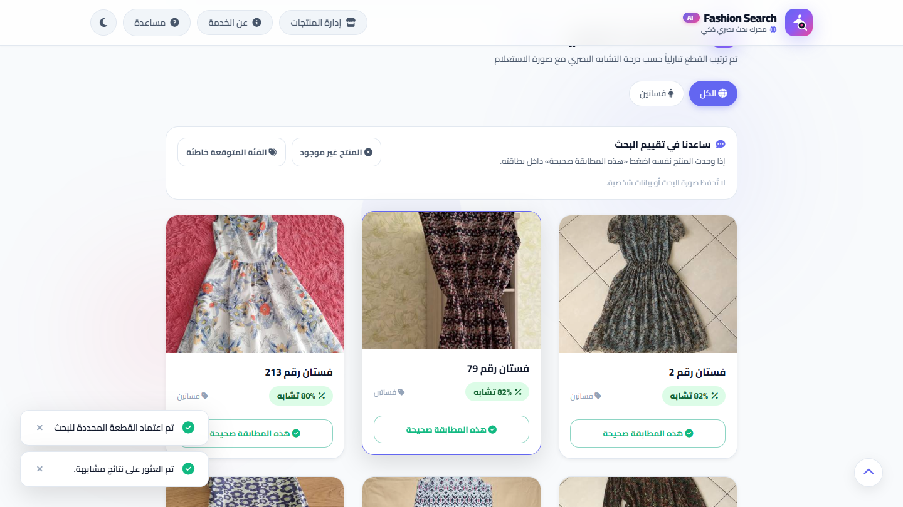

# LibaasLens | عدسة لباس

**الاسم الأكاديمي: Visual Fashion Product Search Using Interactive Segmentation**

تطبيق محلي للبحث عن الملابس بالصورة. يرفع المستخدم صورة كاملة، أو يحدد القطعة المقصودة عبر **SAM2.1** أو الأدوات اليدوية، ثم يقارن **SigLIP2** تمثيلها بصور الكتالوج ويرتب **FAISS** النتائج. الخادم **FastAPI**، وإدارة المنتجات تستخدم **SQLite**.

**الفريق:** Nasser Yousef / Noor Yousef / Naeem Basalma. **الإشراف الأكاديمي:** Dr. Ayman Alsabri. **الجامعة:** International University of Technology Twintech.

[English](README.md) · [فهرس الوثائق](docs/INDEX.md) · [مجلد التسليم](docs/submission/README_AR.md) · [حقوق الفريق](COPYRIGHT_AR.md)

## ما الذي يعمل الآن

- البحث بالصورة الكاملة أو القطعة المحددة، مع مراجعة القصاصة ونقاط موجبة وسالبة لتصحيح التحديد.
- اختيار يدوي بالمستطيل والمضلع والرسم الحر، وتحديد الفئة أو البحث في جميع الفئات.
- كتالوج أصلي يضم **3,068 صورة**، وكتالوج مستقل للمنتجات المضافة من الموقع.
- أدمن محلي واحد يضيف المنتجات ويعدلها ويحذفها، مع 1 إلى 5 صور وسعر اختياري وعملة وتوفر، ونسخ احتياطي واسترجاع.
- بحث متاح للزائر دون حساب. النظام الحالي ليس سوقًا متعدد البائعين ولا نظام دفع وطلبات.

## التشغيل من جهاز الفريق

افتح `Start_Demo.cmd` أو اختصار سطح المكتب الموجود وانتظر الجاهزية. يفتح التطبيق على <http://127.0.0.1:8000/>، ولا يحتاج فتح PyCharm. لم يتغير مسار المشروع المحلي عند اعتماد الاسم الجديد.

للتثبيت النظيف راجع [دليل حزمة Windows](RUNTIME_README_AR.md) و[إصدار موارد التشغيل](https://github.com/nasserco09/LibaasLens/releases/tag/runtime-rc9-v1). الكود وحده لا يتضمن الأوزان والصور الثقيلة. الحزمة المنشورة تشمل النموذجين المستخدمين وصور المعرض والفهرس، وتحتاج إعداد Python والمكتبات. بيانات الحسابات والمنتجات الشخصية غير منشورة.

## كيف نقرأ النتائج

| التجربة | النتيجة | الحد الذي يجب ذكره |
| --- | --- | --- |
| مقارنة خمسة مرمّزات على 341 صورة تحقق | تصدر SigLIP2 بصحة فئة أول نتيجة 91.50% | لا تثبت أنه الأفضل عالميًا |
| 100 استعلام مركب تاريخي | 46% للصورة الكاملة مقابل 75% بعد تحديد القطعة | تحسن 29 نقطة مئوية في صحة الفئة، وليس هوية المنتج التجاري |
| دراسة توجيه منفصلة على 372 صورة نظيفة | 92.20% إلى 96.24% | بروتوكول آخر، لا يُجمع مع تجربة التحديد |

الدرجة على بطاقة المنتج **تشابه بصري وليست احتمال مطابقة تجارية**. بقي الفهرس الأصلي لأن قص صور الكتالوج لم يثبت فائدة ثابتة كافية. [التفاصيل وحدود التقييم](docs/TECHNICAL_GUIDE.md).

## الملفات المعتمدة

[إصدار مواد التسليم الجامعي](https://github.com/nasserco09/LibaasLens/releases/tag/submission-2026-v2) يجمع الملفات الحالية وإشعارات النسبة والحقوق. موارد تشغيل التطبيق في إصدار مستقل مذكور أعلاه.

- [الوثيقة النهائية PDF](docs/final_report/preview/AI_Visual_Product_Search_Submission_2026.pdf) و[مصادر LaTeX](docs/final_report/README_AR.md).
- [العرض القابل للتعديل](docs/final_presentation/exports/Visual_Fashion_Search_Defense_2026_v3.pptx) و[نسخة PDF](docs/final_presentation/exports/Visual_Fashion_Search_Defense_2026_v3.pdf).
- [بوستر الطباعة 250 × 140 سم](docs/poster/preview/Visual_Fashion_Search_Poster_250x140cm.pdf) و[مصادر التعديل](docs/poster/README_AR.md).
- [فيديو استخدام البرنامج الصامت، 49 ثانية](docs/final_video/exports/LibaasLens_Application_Walkthrough_Silent_v2.mp4) و[مصادره القابلة للتعديل](docs/final_video/README_AR.md).
- [حالة التسليم](docs/UNIVERSITY_SUBMISSION_2026_AR.md) و[ترتيب الحزمة](docs/submission/README_AR.md).

اعتمد الفريق العرض وأكد تشغيل الموقع في **14 نوفمبر 2026**. وبطلب لاحق من الفريق أُعد فيديو v2 صامت وقصير يشرح استخدام البرنامج فقط، بنصوص إنجليزية وشعار الجامعة. الفيديو السابق محفوظ في لقطة v1. التوقيعات والختم الفعلي تؤخذ من أصحابها. ملفات المناقشة الأولية محفوظة تاريخيًا، وليست بديل الملفات الحالية.

## الحقوق والنسبة

حقوق المواد الأصلية المملوكة للفريق محفوظة باسم **Nasser Yousef وNoor Yousef وNaeem Basalma**، مع توثيق المشرف في [AUTHORS](AUTHORS.md). يوضح [LICENSE](LICENSE) الإذن المحدود للتقييم الجامعي، ولا يمنح ترخيصًا مفتوحًا أو إذنًا تجاريًا عامًا. استخدم [CITATION.cff](CITATION.cff) للاستشهاد بالمشروع.

حقوق النماذج والداتا والمكتبات والخطوط وشعار الجامعة منفصلة. التفاصيل في [إشعار المكونات الخارجية](THIRD_PARTY_NOTICES.md) و[شرح الحقوق](COPYRIGHT_AR.md). نشر المستودع يوثق إتاحة النسخة وتاريخها، لكنه ليس تسجيل علامة تجارية أو ضمانًا قانونيًا مطلقًا للملكية.
